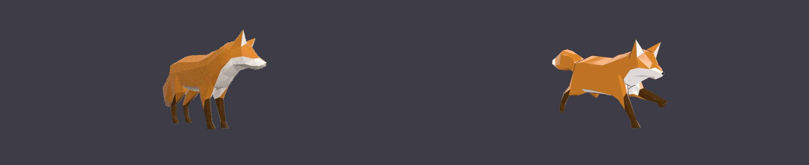

# deskpet

用 Rust 写的 macOS 3D 桌宠引擎，也给 agent 提供制作桌宠的工具。透明置顶窗口、Retina 原生分辨率实时渲染、可交互，目标是全天常驻也不耗电。完整方案见 [docs/ROADMAP.md](docs/ROADMAP.md)。



## 运行

```bash
cargo run --release                                  # 默认 pets/fox，实物风格
cargo run --release -- --style anime                 # real | anime
cargo run --release -- --pet pets/fox --power eco    # eco | balanced | smooth
```

## 给 agent 用的工具

```bash
deskpet new pets/cat --model cat.glb --name 猫     # 从 glb 生成宠物包，猜测项标 GUESS
deskpet check pets/cat                           # 检查资产和预算；--json 给程序读，出错退出码 1
deskpet render pets/cat                          # 渲染联系表 pets/cat/contact.png
```

联系表每种风格一组：一圈 360° 转台、每个动画一行（首帧到末帧）、头部朝四个方向看和眨眼。`check` 检查清单名字、授权、面数和贴图、蒙皮权重、待机循环接缝、动作切换跳变、每帧 GPU 耗时、宠物在窗口里的占比。

[skills/deskpet/SKILL.md](skills/deskpet/SKILL.md) 是给 Claude Code 的 skill，教 agent 按"起稿、渲染、看图、改进"做宠物。复制到 `~/.claude/skills/deskpet/` 即可使用。

## 交互

左键点一下有反应，按住拖动挪位置；右键拖动旋转；Esc 退出。宠物以外的透明区域点击穿透到下层窗口。

## 宠物包

一个目录就是一只宠物：`pet.toml` 加 glTF 模型（`.glb` 或 `.gltf`）和授权文件。示例见 [pets/fox/pet.toml](pets/fox/pet.toml)。

| 字段 | 含义 |
|---|---|
| `name`、`model` | 名字和模型文件 |
| `facing` | 绕 Y 轴旋转多少度朝向镜头 |
| `height` | 窗口高度（点） |
| `style` | 默认风格名 |
| `[animations]` | `idle` 待机循环、`fidget` 空闲时随机穿插的小动作、`react` 点击反应，填 glTF 动画名 |
| `[rig]` | `head` 跟随鼠标转动的骨骼、`look_limit` 最大转角、`blink` 闭眼用的 morph target |
| `[styles.<名字>]` | `kind`（real / anime）、`tint`、`outline`、`outline_color`、`fur`、`glow`、`bands` |

名字写错（动画、骨骼、morph、风格）启动时就会报错并指出是哪一项。

## 引擎

- **模型**：glTF 网格、贴图（带 mipmap 和各向异性过滤）、骨骼蒙皮、morph target（最多 32 个）、动画剪辑（线性、阶跃、三次样条）。蒙皮和 morph 都在 GPU 上算。
- **风格**：一个着色器两种着色。
  - 实物：包裹漫反射模拟毛发透光、天空和桌面两色环境光、GGX 高光、轮廓光，外加 16 层壳体毛发（shell fur）。
  - 动漫：分层卡通着色、阴影偏冷色、硬边高光，加反向外壳描边。
- **行为**：待机循环，空闲时随机穿插小动作，点击反应，动作之间 0.35 秒平滑过渡；头部跟随鼠标；有闭眼 morph 时随机眨眼，偶尔连眨两下；打盹时呼吸放慢、不再做小动作。
- **点击穿透**：光标射线和当前姿势的网格逐三角形求交，腿缝之间也能点穿。
- **取景**：按所有动画、任意旋转角度下的包围盒定窗口大小，宠物不会走出窗口。
- **省电**：优先集成显卡，vsync；只在帧到期时重绘，按交互中、空闲（2 秒后）、打盹（60 秒后）三档降帧，播放动作期间临时满帧；窗口被遮挡时停止渲染。

| 档位 | 帧率：交互中 / 空闲 / 打盹 |
|---|---|
| `eco` | 30 / 12 / 4 |
| `balanced`（默认） | 60 / 24 / 8 |
| `smooth` | 120 / 30 / 10 |

实测（M 系列，release，狐狸 1728 顶点，空闲 10 秒平均）：balanced 两种风格都在 4%–5% CPU，eco 2%，内存约 80–90 MB。

## 素材授权

`pets/fox` 的狐狸模型来自 [Khronos glTF Sample Assets](https://github.com/KhronosGroup/glTF-Sample-Assets/tree/main/Models/Fox)，CC0 / CC-BY 4.0，见 [pets/fox/LICENSE.md](pets/fox/LICENSE.md)。
